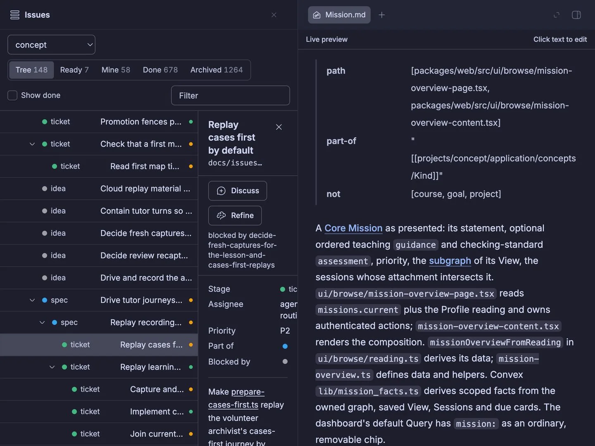
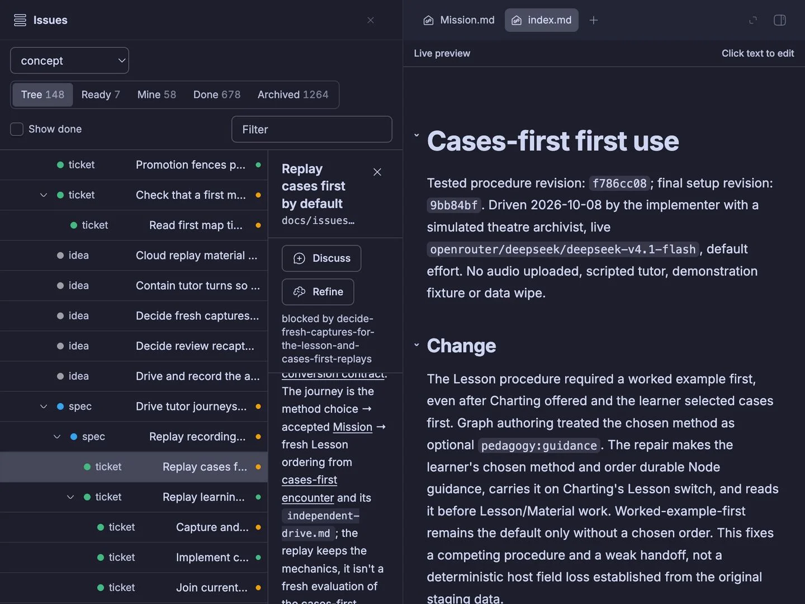
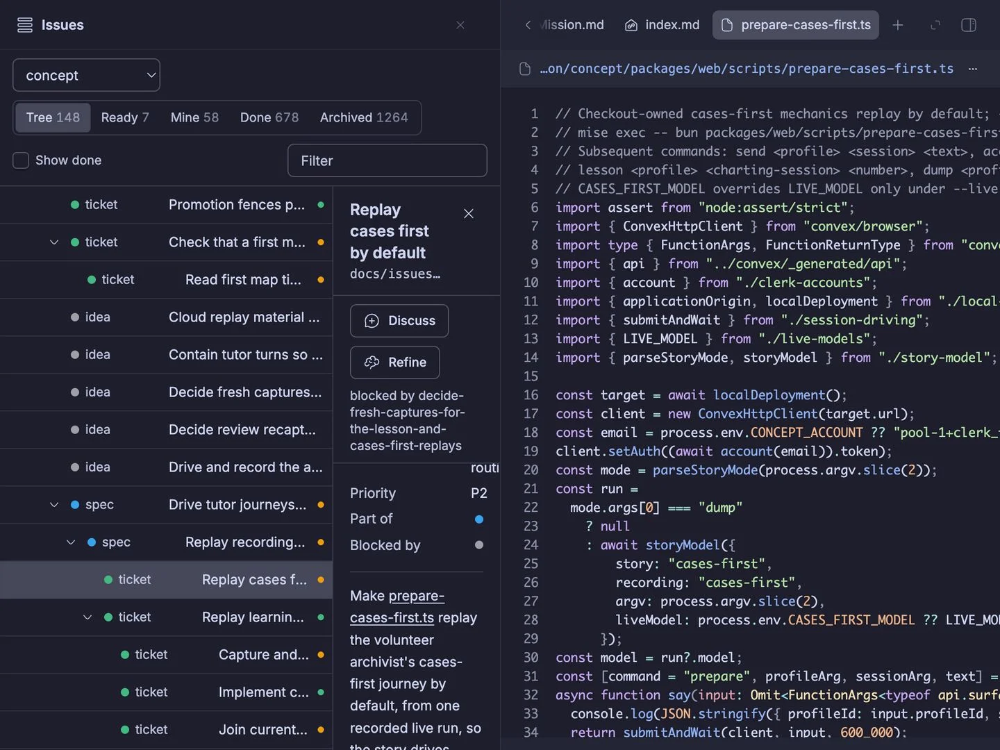

# Signed-in desktop first use

## Predictions (before opening the pane)

Mission should open the concept Markdown in a file preview. The attachment should open its Markdown index in a file preview. `prepare-cases-first.ts` should open the repository source file in a file preview, rather than navigating the plugin frame.

## Setup

2026-10-25, worker `thr_8mx3mvqvvh`. Mac host `host_w74xscm3fz`, installed tracker source `/Users/mlegls/dev/mlegls-pi/bb/tracker`. Readiness: checkout is clean on `main` at `7dbc39e56e251d51cac8bf88487edc3cec3316c9`; `git merge-base --is-ancestor 2b6d8577 HEAD` succeeded, so no fast-forward was necessary. `bb plugin build bb/tracker && bb plugin reload tracker` completed, reporting tracker running. No seed changes. Persona: owner's existing signed-in bb desktop profile; no credentials copied.

Entry: https://mlegls.getbb.app/plugins/tracker/issues/proj_fgz6kudzrk/replay-cases-first-by-default

Bundled Browser Automation was disabled; enabled temporarily for this encounter. Its desktop session supplies snapshot-ref clicks rather than manual CDP. Opens exceeded CLI waits of 120s and 180s while downloading its runtime (0%, later 10%). `list` reported ready, but `run` returned “Session stopped, expired, or worker restarted”. Both sessions were closed. [Filed BB plugin friction](../../issues/bb-browser-automation-ready-before-runtime-download-finishes.md). Core `bb browser` with host-local Node WebSocket CDP worked without a runtime download.

The issue's current body had replaced the requested links with code/plain text. Restored just these three references through the concept tracker, committed there as `92e52c1cd` (`tracker: update replay-cases-first-by-default`); no story behavior changed. Reloaded the browser tab and observed all three anchors before clicking.

## Encounter and results

Live desktop browser, 1920×1080, English UI, dark appearance. Screenshots below crop away the unrelated personal thread sidebar (leftmost 480px). No fixtures or mocked previews.

| Prediction / replay check | Action | Observed result |
| --- | --- | --- |
| Concept opens a preview | Click `Mission` | Held: `Mission.md` preview rendered “A Core Mission as presented” and the concept body. |
| Attachment opens a preview | Click `cases-first encounter` | Held: `index.md` preview rendered “Cases-first first use”, tested revisions and the Change section. |
| Repository file opens a preview | Click `prepare-cases-first.ts` | Held: source preview showed the correct `/Users/mlegls/dev/mmon/concept/packages/web/scripts/prepare-cases-first.ts` path, numbered lines and TypeScript. Waited past its loading skeleton before recording. |

Pointer actions used the rendered anchor's first client rectangle and CDP mouse press/release. The initial attachment attempt used the center of its multiline bounding box, which hit whitespace and left Mission selected; clicking the first text rectangle opened the attachment. This was a diagnostic click-coordinate mistake, not a tracker failure.

## Reproduce from committed setup

Required environment: the installed tracker on the Mac host above, its existing concept vault and owner's signed-in bb desktop profile. No model secrets, seed or anonymous-local substitute. Before reloading, confirm the checkout remains clean on `main` and contains `2b6d8577`. The prepared target was built and reloaded, and the entry URL above was opened successfully in that profile.

1. `bb browser instances --host host_w74xscm3fz --json`; use the returned instance and generation, not stale identifiers from this packet.
2. With `--host`, `--instance`, `--generation`, and `--thread` on every core browser call: `bb browser create --url <entry URL>`; `bb browser acquire <tab> --controller tracker-first-use --ttl-ms 1800000`.
3. On that same Mac host, `bb browser connection <lease> --output <new-private-file>` with those same selectors. Never print or transfer its endpoint. Copy [desktop-cdp.cjs](desktop-cdp.cjs) to that host if running from a Linux worker (`bb file write --host host_w74xscm3fz <path> --stdin`).
4. `node desktop-cdp.cjs <private-file>` inspects the links. Run it again with one observed link label (`Mission`, `cases-first encounter`, `prepare-cases-first.ts`) to click. `bb browser capture <tab> --output <new-image>` saves a screenshot on the CLI host; wait for the preview to load, then inspect it. The helper is the small diagnostic used for this encounter, not a permanent test.
5. Close any file-preview tabs you opened, then `bb browser release <lease>` and `bb browser close <tab>` with the selectors above; remove the private connection file. With Browser Automation instead, its desktop `close` releases and closes its owned tab; restore its previous enabled state.

## Cleanup and limits

Owned desktop tab and its three file previews closed; lease released. Browser Automation restored to disabled. Owned Mac terminal sessions closed and scratch connection/scripts removed. The installed tracker remains rebuilt/reloaded, as requested. No dev server or tunnel started.

This encounter proves only the requested three rendered links. It does not newly claim missing-file presentation or in-page issue navigation; those were outside this ticket's three-click check. bb Connect itself was trusted, not separately tested. No new permanent tests were added for this documentation/first-use change.
