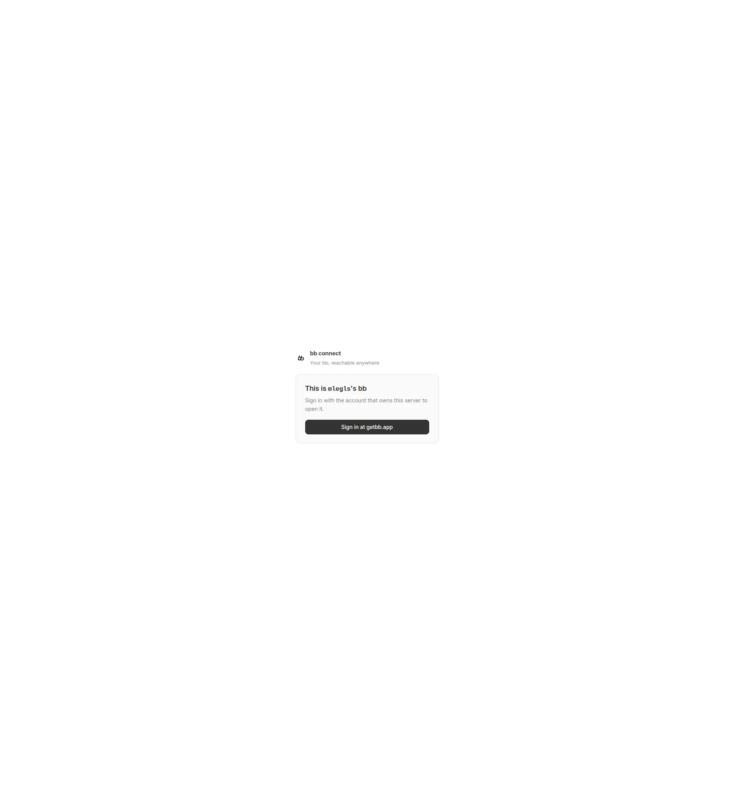

# Independent drive, second attempt

Revision: ff3bff903ead568550c326bf8b24b4c2f1b20ef8.

## Predictions before opening

As a remote issue reader I expect Mission to open a concept note in bb, the attachment link to open its Markdown packet, and the repository script to open a file preview. I expect issue wikilinks to stay within the pane, external links to remain external, missing files to be non-clickable with an explanation, and known cross-project links to open their note. These are unobserved predictions, not outcomes.

## Observed outcome

Blocked before the product surface: the entry URL displayed bb Connect, with “Sign in with the account that owns this server to open it.” No issue pane was reachable. All predicted link outcomes remain **unobservable**; none failed or passed. The page was closed; no server, plugin, tunnel or deployment was started or changed.

Friction: authenticated-browser setup remains unavailable, tracked by [[projects/mlegls-pi/issues/remote-bb-pane-drive-needs-authenticated-browser]]. Installing another preview plugin would not remove the account gate, so no remote deployment was created.

Replayable check: open the supplied entry URL in the session-private browser; accept setup only when the authenticated bb shell and target issue pane appear. Then click Mission, the attachment and repository script; accept each only when its corresponding preview is visible. In-page issue navigation, missing-file title/plain text, external URLs, and cross-project links still need their own observed actions after authentication. All expectations remain unmet at setup, unobservable in the product.

## Setup preflight

Required: authenticated bb browser with Obsidian at Home; concept issue replay-cases-first-by-default. The implementer's isolated server-host plugin was removed after its trial. No owned deployment is currently prepared. Before attempting authorized reinstallation, check whether this session's browser can reach the required authenticated bb shell. No destructive seed is required or authorized. The supplied entry URL is https://mlegls.getbb.app/plugins/tracker-link-preview/issues/proj_fgz6kudzrk/replay-cases-first-by-default .
