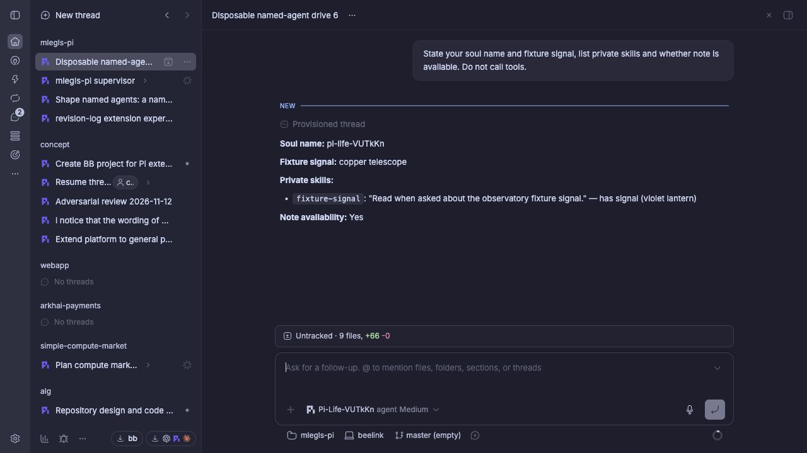
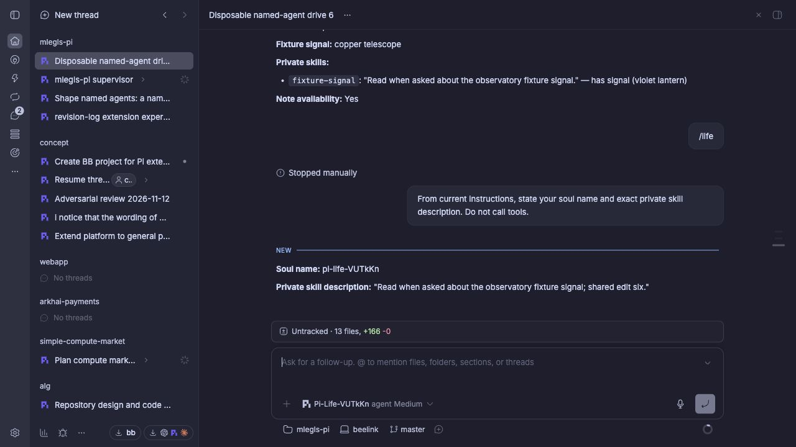

# Independent named-agent first use

Tested revision: `12eb94166ae740ffa8aa3e721cc0a732e72b0704`, 2026-11-12, installed pi 1.5.0. CLI print/RPC plus signed-in BB desktop browser. No product source, diffs, tests or fixtures read; no repository checks run.

## Predictions written before opening the product

1. Fresh `agent/<fixture>` startup will speak of copper telescope, list fixture-signal, expose note despite disabled global notes, and enter the shared present.
2. A second ordinary-model session will start with none of these; `/life /<fixture>` will supply them. Changes to the private skill description will appear next run in the sibling. `/memory -notes` removes note, model changes preserve identity, and `/life off` removes identity.
3. Choosing an agent model after messages will only switch the model. An ordinary stance worker without PI_LIFE will have no identity.
4. Resume and fork will inherit the attachment; explicit off will survive resume.
5. A fresh BB thread on the fixture agent model will acquire the same identity, and its environment model catalog will list that virtual model.

## Setup and readiness

Used the [guide](../../../extensions/context/life/README.md#named-agent-first-use) command `bun scripts/life-playground.ts prepare-agent-bb` from this checkout. It exited zero and created my disposable `/tmp/pi-life-VUTkKn`, name `/pi-life-VUTkKn`. This avoids reusing the implementer's retained/edited fixture. The guide specifies isolated store, workspace-only registry, disabled global notes, existing installed Anthropic authentication and `anthropic/claude-haiku-4-5:off`; no credentials were inspected. Explicit agent-model startup settled successfully, establishing credentialed readiness before further driving.

Entry:

```sh
bun scripts/life-playground.ts start /tmp/pi-life-VUTkKn one --model agent/pi-life-VUTkKn --print 'What is your soul name and fixture signal? List private skills with their exact descriptions, and whether note is available. Read your private skill and give its signal.'
```

Then maintained two actual pi subprocesses through the same launcher using `--mode rpc`; commands are LF-delimited JSON, correlated by ID. Waited for `agent_settled` on ordinary prompts; slash commands returned `disposition: handled`. All subprocesses closed stdin and exited after use. Scratch clients were encounter automation, not a new test suite.

BB thread `thr_skrzxhra7c` was explicitly created in this owned root in existing project `proj_xzgxqiaesb`. `bb thread show` established environment `env_3vsgns3eba`, host `host_a22uydxjy2`, exact path `/tmp/pi-life-VUTkKn`, ready environment and idle thread before browser interaction. Used the discovered Mac BB desktop instance and its signed-in profile, via browser-automation session `d2071397-be9f-4954-8cd6-0a49415e7876`. Plugin was already enabled and left unchanged.

## Encounter and outcomes

### Fresh startup, private skill and note — held

The print entry answered soul `pi-life-VUTkKn`, **copper telescope**, private skill `fixture-signal` with exact description `Read when asked about the observatory fixture signal.`, note available, and **violet lantern** after reading the private skill.

An independent fresh RPC slot `delta --model agent/pi-life-VUTkKn` emitted an actual initial system section `agent` containing the observatory soul and fixture-owned paths. Its `toolsAdded` were `read bash edit write journal hold catch_up zoom date note recall`. This confirms actual note availability beyond self-report.

### Ordinary session, intentional attach and shared edit — held

Started two with `--no-life-env --model anthropic/claude-haiku-4-5`. Asked for soul/private skills/note from current instructions without reading files. It named general ambient CLI conventions rather than a soul, and explicitly listed no note among its available tools. No fixture name or private skill appeared.

Sent `/life /pi-life-VUTkKn`: notice `Life: /pi-life-VUTkKn (/pi-life-VUTkKn)`. Its next ordinary run answered the same soul, copper telescope, original private description and note available.

Resumed one using `--no-life-env`; asked it to edit its private skill description to exactly `Read when asked about the observatory fixture signal; shared edit six.` and commit that file. It reported completion. Two, still open, quoted that exact new description on its next run without reading files. The already-open BB thread subsequently quoted it too, without restart (second screenshot).

### Model change, note opt-out, detach, late agent selection — held

On the fresh agent-selected delta session, RPC `set_model` to `anthropic/claude-haiku-4-5` succeeded. The next run emitted no agent/skill removal or note removal. This was a real virtual-agent → ordinary-model change; an earlier two-session selection had selected the already-current Haiku and was insufficient on its own.

`/memory -notes` returned handled and `Memory: life (compaction, context); off: journal, om, elide, notes`. The next actual system delta removed `note`. Two also answered `Note is unavailable` when asked to use it if present.

`/life off` returned `Life: off`. Next system delta:

```json
{"sections":{"skills":null,"agent":null},"toolsRemoved":[{"name":"hold"},{"name":"catch_up"},{"name":"zoom"},{"name":"date"}]}
```

After these messages, selecting agent/pi-life-VUTkKn returned success plus `Use /life /pi-life-VUTkKn to attach this session's history to the agent`. The following run emitted no system addition. In two, `/life` explicitly remained off after the same late selection, and the next answer found neither soul nor private skill in current instructions.

### Resume/fork, stance isolation and present — held

Exited one and resumed with `start <root> one --no-life-env`: `/life` still reported `/pi-life-VUTkKn`, and an ordinary prompt named the soul and edited private description.

Fork entry:

```sh
bun scripts/life-playground.ts start /tmp/pi-life-VUTkKn forked --no-life-env --fork /tmp/pi-life-VUTkKn/sessions/one/2026-11-12T04-58-45-508Z_01a1ce1f-6184-7053-9d94-166a5307f0c3.jsonl --model anthropic/claude-haiku-4-5 --mode rpc
```

The fork's `/life` reported the attachment and its next run named the same soul/edited skill. Resumed explicitly detached two with `--no-life-env`: `/life` reported off (also `Memory: life is disabled in settings`).

A new `worker --no-life-env --model stance/auto-routine` answered no agent soul, no private fixture skills and no note, while journal/recall remained available.

Started another agent slot busy, asked it to execute `sleep 12`, then asked one about the current shared Working present without tools. One reported the BB sibling `thr_skrzxhra7c`, busy session `01a1ce22-4a49-7721-bcf3-02ec16c073f4` with the exact sleep task, and its own session `01a1ce1f-6184-7053-9d94-166a5307f0c3`. Busy settled and exited afterwards. This is a sibling's observation through its supplied present, rather than an internal store inspection.

### BB post-start model selection and visible first use — held

Spawned with `--provider pi --model agent/pi-life-VUTkKn` and the guide's short identity prompt. In the signed-in browser, clicked the newly created disposable thread. Reply visibly included soul `pi-life-VUTkKn`, copper telescope, fixture-signal with the original description and note availability Yes. The composer displayed `Pi-Life-VUTkKn (agent) · Medium`.

`bb provider models pi --environment env_3vsgns3eba --json` returned ID/model `agent/pi-life-VUTkKn`, displayName `pi-life-VUTkKn (agent)`. This is the environment-specific automation selector.



1280×720, signed-in desktop browser, live disposable fixture, English BB UI. Soul, skill and note are legible alongside the virtual agent model.

Tried `/life` from the user composer. Submission stayed active with Stop run, as the guide predicts. Clicked Stop run; sent an ordinary follow-up asking for current soul and exact private description. It succeeded and quoted the terminal session's edited description:



1280×720, same live thread. Shows the manually stopped slash submission and successful ordinary follow-up with `shared edit six.`

## Expectations, frictions and replayable checks

- Predictions 1–5: **met**, with the concrete observations above. Attachment state was checked with `/life`; tool/detach transitions additionally used actual RPC system deltas to avoid trusting stale conversation claims.
- Expected a real model change in the initial two-session pass: **not met** because Haiku was already selected. Replayed in fresh agent-selected delta slot and observed virtual → ordinary switch preserving identity.
- Expected private skill commit to be uneventful: **not met**. Saw `life: compaction failed: empty reply`, but edit request completed and sibling read the new description next run. Added this occurrence immediately to existing [compaction warning issue](../../issues/life-first-use-compaction-empty-reply-warning.md). Cause and data-loss impact unestablished.
- BB handled-slash submission remained active: expected from guide, observed; Stop then ordinary prompt worked. Existing owner [get-bb/bb#3792](https://github.com/get-bb/bb/issues/3792). No new duplicate filed.
- Tracker `outline` reported `no vault note has directory`; used `snapshot --json` to find the existing issue. This is already an [accepted host limitation](../../issues/tracker-outline-has-no-project-vault-note.md).
- Scratch `python` command was unavailable; `python3` worked immediately. This was not a project setup command and did not affect the fixture.

Checks for replay:

1. Prepare fresh root; print with agent selector and ask to read private skill. Accept exact soul, copper telescope, violet lantern, private description and actual note schema.
2. Keep two RPC processes open; attach ordinary sibling, ask one to edit/commit description, ask sibling next run without file tools. Accept exact changed description without reload. Watch for compaction warning separately; a successful reply alone does not establish compaction success.
3. Start agent-selected slot, switch to ordinary model, prompt; accept no soul/skill/tool removal. Opt out notes and detach; accept note removal then null agent/skills. Re-select virtual model after history; accept explicit-attach notice and no additions.
4. Resume attached and off slots, fork attached slot on ordinary model, and launch fresh stance worker without override. Accept respective attachment/identity state through `/life` and ordinary prompts.
5. While sibling sleeps, prompt attached session for Working present; accept exact busy session and task. Wait for both to settle before shutdown.
6. Spawn BB fixture model; confirm ready exact owned environment before browser use, catalog ID, rendered identity/skill/note and model label. Submit `/life` from composer, Stop its pending submission, send ordinary prompt; accept normal follow-up and updated skill description.

## Cleanup

All CLI processes exited. Browser automation session closed, releasing its lease and owned tab. BB trial thread stopped and archived. `untrust /tmp/pi-life-VUTkKn` completed successfully. Disposable root retained for replay; no inherited/shared services stopped, and no servers, tunnels or browser sessions left running. No product repairs or new tests were made.
