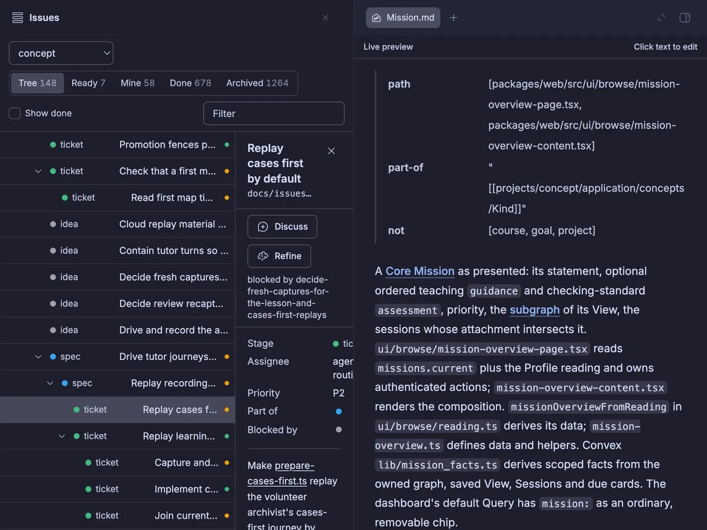
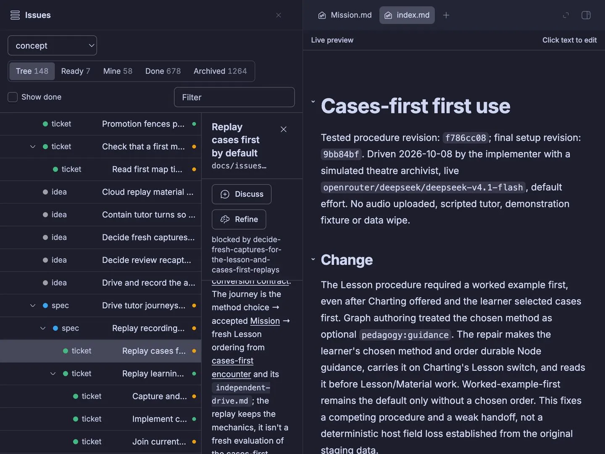
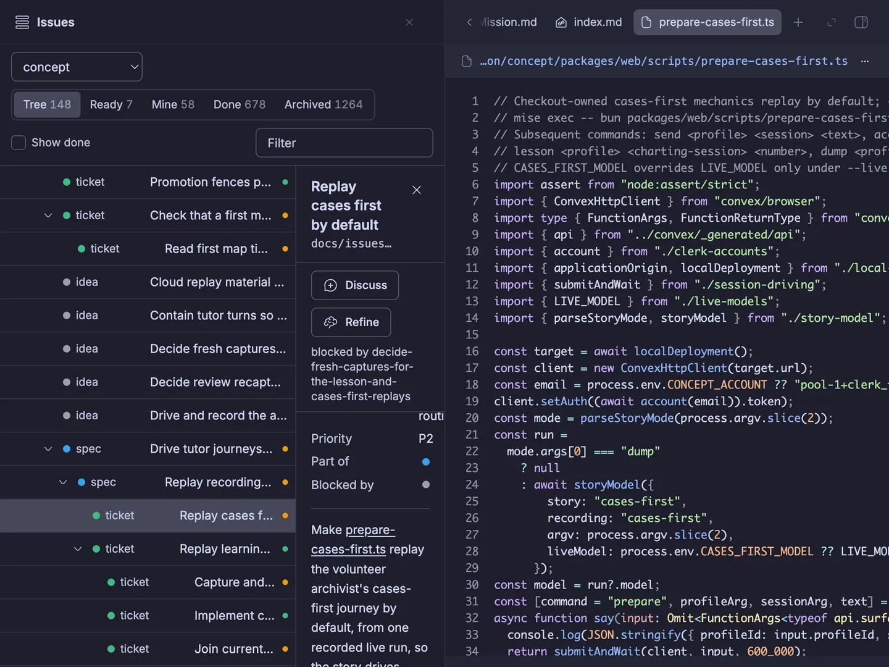

# Independent drive predictions

Before opening the product (2026-10-25): I expect the desktop browser to use the existing owner session without sign-in; Mission, the attachment, and prepare-cases-first.ts should each open a readable file preview. I expect discovery, exclusive control, capture, release and tab closure to work without copying credentials. Connect itself is trusted, not under test.

Required setup: Mac host_w74xscm3fz, /Users/mlegls/dev/mlegls-pi/bb/tracker, clean main containing 2b6d8577, existing concept vault, no seeding. Entry: https://mlegls.getbb.app/plugins/tracker/issues/proj_fgz6kudzrk/replay-cases-first-by-default . Current CLI discovery found one desktop instance and tracker running at the expected root.

## Encounter

Actual Mac checkout: clean `main` at `b4154cb8faf372a052ffc2f4caf17686c065af88`, ancestor check for `2b6d8577` returned 0. Inherited tracker running with compatible bundle `6fb0839648671502`; no rebuild, data changes or reload necessary for this independent replay. Desktop tab was owned by thread `thr_t74vfrwdtt`, separately created and leased. The committed desktop-cdp.cjs diagnostic was copied to the Mac; its rendered-anchor first-rectangle clicks controlled only the leased tab. Connection stayed private on that host.

All four predictions met: entry opened Issues without sign-in; clicking Mission opened Mission.md with “A Core Mission as presented”; clicking cases-first encounter opened index.md with “Cases-first first use” and Change; clicking prepare-cases-first.ts opened the matching numbered TypeScript source preview. Live 1920×1080 English dark UI; images crop away the unrelated 480px personal sidebar.

## Replayable checks and frictions

Repeat the discovery/create/acquire/host-local connection steps in [the committed first-use setup](../bb-tracker-follows-every-link-in-an-issue/desktop-first-use.md), then click each of the three labels above. Accept only the corresponding loaded readable preview, not just an anchor or loading skeleton. Release the lease and close the owned tab afterwards. This independent encounter confirms that setup, not Connect itself.

Browser Automation command is unavailable while disabled, as documented; used the supplied core-CDP fallback without enabling plugins. Existing runtime-download friction is already owned by [bb-browser-automation-ready-before-runtime-download-finishes](../../issues/bb-browser-automation-ready-before-runtime-download-finishes.md); not encountered anew here. No product failure or new unresolved friction observed. Evidence preparation needed `uv run --with pillow python` because system Python lacked Pillow; no installation persisted. One scratch DOM-inspection helper initially included the read tool header and failed syntax; removed the header and retried successfully, without product impact.

## Cleanup and limits

Closed all three previews using their exact Close labels (all returned found/closed), released lease and closed owned browser tab. Removed all four Mac scratch files and closed owned terminals. No dev server, tunnel or plugin state change. No source, tests or implementation diff inspected; task 1's documentation edits are not assessed by this product drive. Only the three requested links and authenticated setup are claimed; no missing-file or navigation regression claim.

## Review (2026-10-25)

Read the diff (verify-story step 2, the drive role's step 3, the first-use record and the filed Browser Automation friction) against this log, and opened all three shots above: each shows the named preview loaded (Mission.md body, index.md "Cases-first first use" with Change, prepare-cases-first.ts with numbered lines and its concept path) beside the signed-in Issues pane, supporting every outcome. Both browser routes are documented with lease release and tab close, and Connect is stated as trusted. Repair: the first-use index listed this replay above the encounter it replays; reordered so the first use leads. No behavior changed, so no re-drive.
